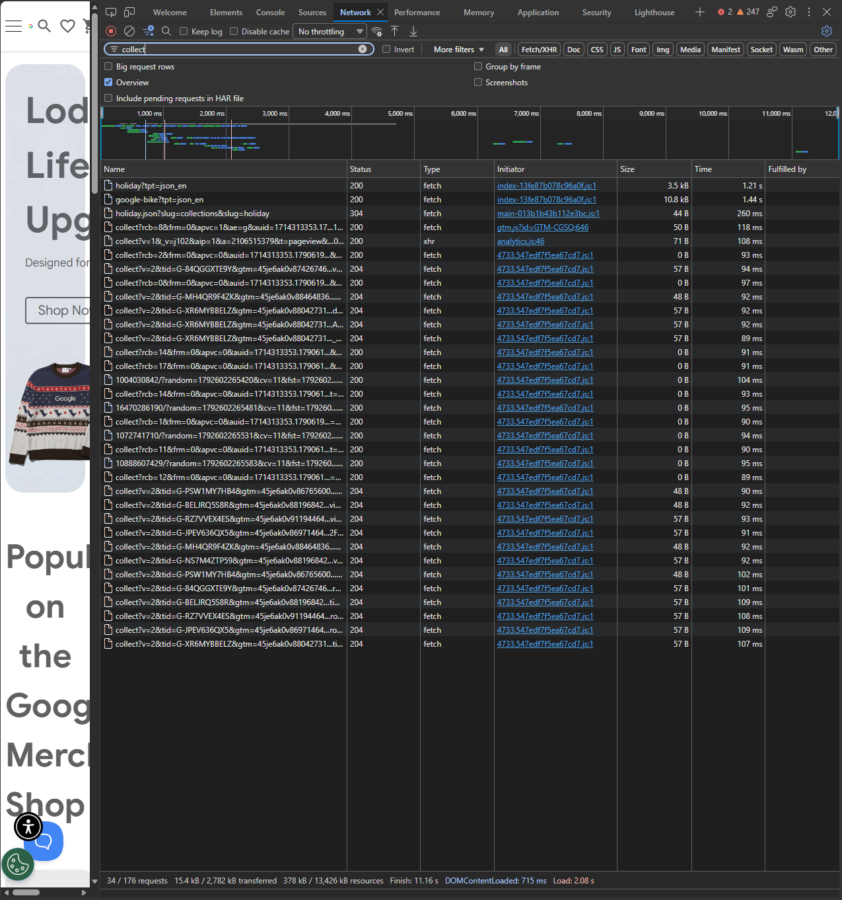
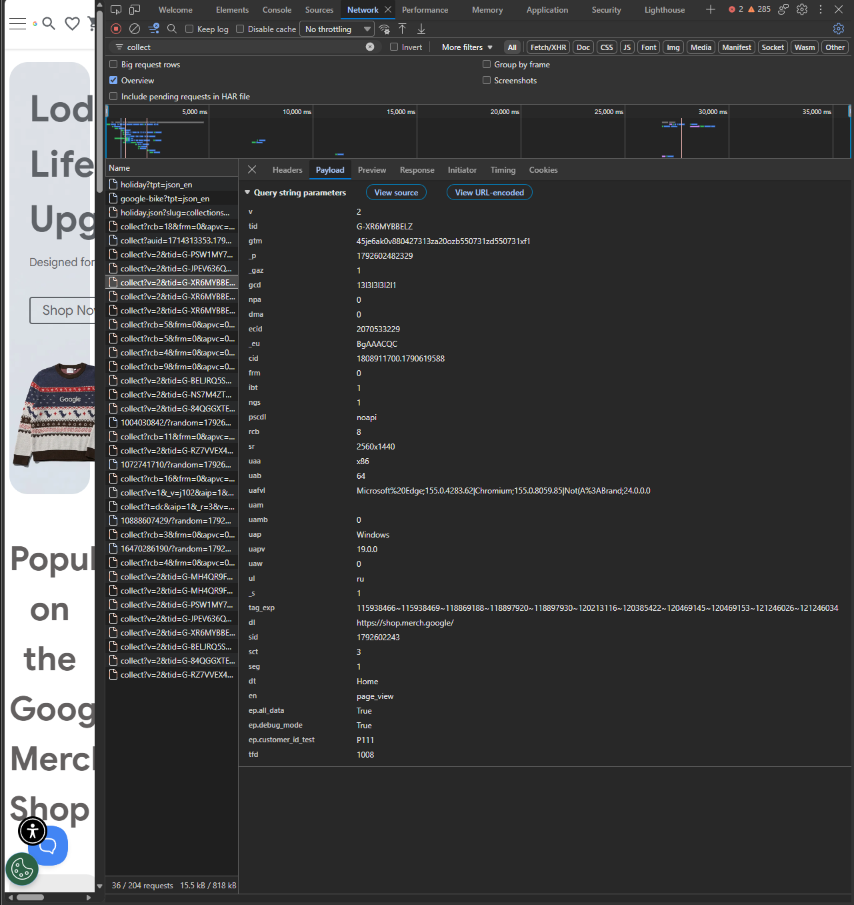

# Домашняя работа № 1 · Путь данных от ссылки до заявки

**Дисциплина:** ОП.03 «Информационные технологии»

| Поле | Значение |
|---|---|
| Фамилия, имя, отчество | Бурмистров Вадим Александрович |
| Группа | 11/1-РПО-26/1 |
| Номер работы | 1 |
| Тема работы | Цифровая воронка: путь данных от ссылки до заявки |
| Дата сдачи | 21.10.2026 |

---

## Задание

1. Открыть сайт, панель разработчика (F12) → **Network**, в фильтре `collect`,
   галочка **Preserve log**.
2. Сделать три действия: обновить страницу, прокрутить до низа, нажать
   на товар. Записать, какие события ушли — параметр `en` на вкладке **Payload**.
3. Описать путь пользователя от ссылки до заявки, пять шагов.
4. Найти одно место на этом пути, где данные могут потеряться.
5. Приложить скриншоты `screens/01-network.png` и `screens/02-payload.png`.

Сайт: https://shop.merch.google/, запасные — https://habr.com/ru/,
https://www.smashingmagazine.com/, https://css-tricks.com/. Открывать
в Chrome или Edge с выключенным блокировщиком рекламы.

Срок — до начала занятия 2. Работа сдаётся коммитом в `main`.

---

## 1. Какой сайт смотрел

| Поле | Значение |
|---|---|
| Название сайта | Google Merchandise Store |
| Адрес | https://shop.merch.google/ |
| Откуда сайт | из списка в задании |

## 2. Три действия и что отправил счётчик

Панель Network, фильтр `collect`, галочка Preserve log. Название события
лежит в параметре `en` на вкладке Payload.

| № | Что я сделал на сайте | Название события (`en`) | Что ещё было в Payload |
|---|---|---|---|
| 1 | обновил страницу | `page_view` | `tid=G-XR6MYBBELZ` — ID потока, `dl=https://shop.merch.google/` — адрес страницы, `dt=Home` — заголовок, `cid` — ID посетителя, `sid` — ID сеанса, `sct=3` — номер сеанса, `ul=ru` — язык браузера, `sr=2560x1440` — разрешение экрана |
| 2 | прокрутил до низа | `scroll` | `epn.percent_scrolled=90` — глубина прокрутки 90 %, те же `dl`, `dt`, `cid` и `sid`. Пока листал, при показе баннеров ушли ещё события `view_promotion` |
| 3 | нажал на товар (промо-баннер с кружкой «Shop Drinkware») | `select_promotion` | `dl=https://shop.merch.google/` — страница, где был клик, `tid=G-MH4QR9F4ZK`. После перехода на `/shop/lifestyle/drinkware` ушёл новый `page_view` |

На сайте стоит сразу несколько счётчиков GA4 (`G-PSW1MY7HB4`, `G-MH4QR9F4ZK`,
`G-XR6MYBBELZ` и другие), поэтому одно действие даёт несколько строк
`collect` с одинаковым `en`, но разным `tid`.

## 3. Путь пользователя: 5 шагов

От ссылки до заявки, своими словами. Панель для этого не нужна: это рассказ
о том, как человек доходит до кнопки «Отправить». В правом столбце стоит
пример, в левом вы пишете свой вариант.

| № | Мой шаг | Пример |
|---|---|---|
| 1 | человек увидел рекламу курса «Веб-аналитика с нуля» и перешёл по ссылке | *человек увидел ссылку в сообществе и нажал на неё* |
| 2 | открылась главная страница, он посмотрел программу курса | *открылась главная страница сайта* |
| 3 | нажал кнопку «Оставить заявку» и прокрутил до формы | *он прокрутил до формы записи* |
| 4 | начал заполнять форму: имя и телефон | *начал заполнять: имя и телефон* |
| 5 | нажал «Отправить», заявка ушла менеджеру | *нажал «Отправить», заявка ушла менеджеру* |

## 4. Где данные могут потеряться

| № | На каком шаге | Что может потеряться |
|---|---|---|
| 1 | между шагами 4 и 5: начал заполнять форму, но не отправил | человек ввёл часть данных и ушёл: событие начала заполнения есть, а заявки нет, и менеджер о нём не узнает |
| 2 | шаг 5, отправка формы | заявка ушла менеджеру, но событие об отправке не дошло до аналитики (блокировщик рекламы, вкладку закрыли сразу после клика) — в отчётах заявок будет меньше, чем у менеджера |

## 5. Использование ИИ

| Вопрос | Ответ |
|---|---|
| Что сделал сам |  |
| Что спросил у модели |  |
| Что после этого изменил |  |
