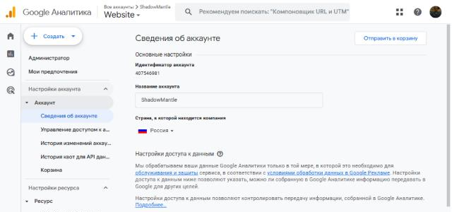
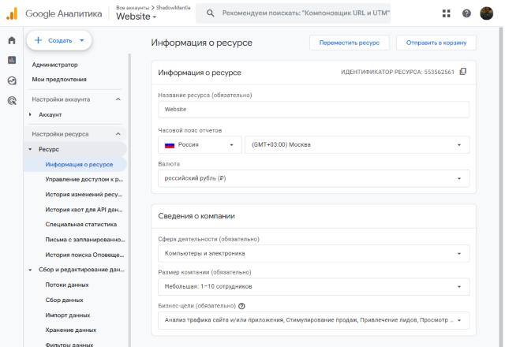
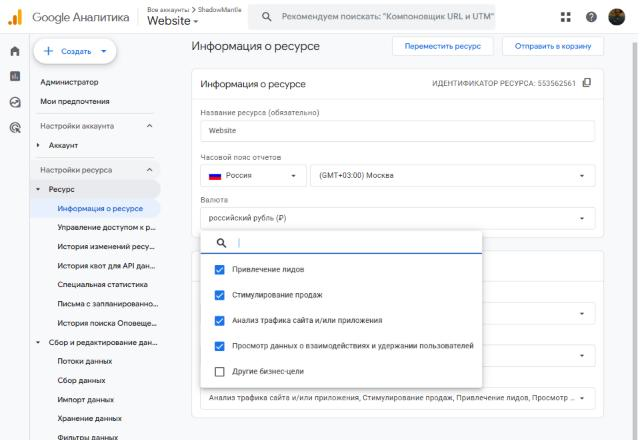
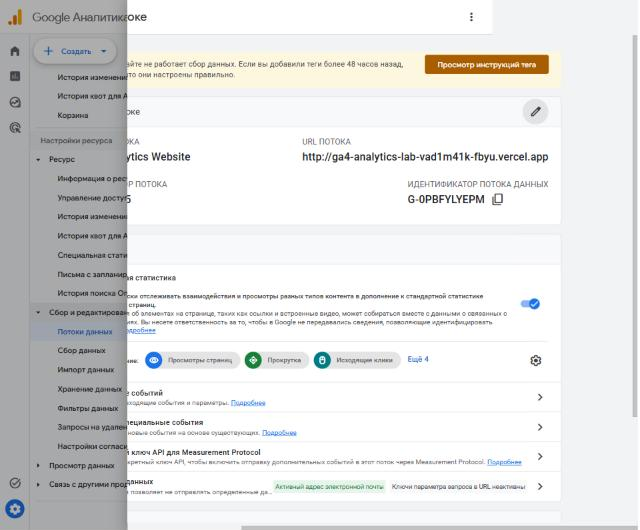
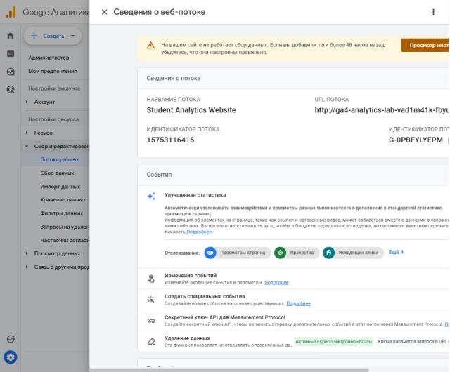

# Домашняя работа № 2 · Где бизнес теряет клиентов

**Дисциплина:** ОП.03 «Информационные технологии»

| Поле | Значение |
|---|---|
| Фамилия, имя, отчество | Бурмистров Вадим Александрович |
| Группа | 11/1-РПО-26/1 |
| Номер работы | 2 |
| Тема работы | Анализ воронки цифрового продукта и структура Google Analytics 4 |
| Дата сдачи | 21.10.2026 |

---

# Часть 1. Исследование воронки

## 1.1. Объект исследования

| Поле | Значение |
|---|---|
| Компания, сервис или отрасль | Hoff — российский интернет-магазин мебели и товаров для дома |
| Адрес сайта или приложения | https://hoff.ru/ |
| Целевое действие | оплаченный онлайн-заказ |
| Почему выбран этот объект | мебель — дорогая покупка с долгим выбором: у товаров для дома и ремонта самый высокий средний чек и одна из самых низких конверсий в e-commerce (источник 3), поэтому на каждом этапе воронки здесь заметно теряются люди, а у мебельных магазинов есть открытые кейсы с цифрами |

## 1.2. Воронка

| № | Этап | Что считается переходом дальше | Метрика этапа |
|---|---|---|---|
| 1 | Реклама или поисковая выдача | клик по объявлению или ссылке ведёт на сайт | CTR объявления, число переходов |
| 2 | Посадочная страница и каталог | посетитель не ушёл сразу, открыл раздел каталога | показатель отказов, глубина просмотра |
| 3 | Карточка товара | открыта карточка конкретного товара | доля сеансов с просмотром карточки |
| 4 | Добавление в корзину | нажата кнопка «В корзину» | конверсия «карточка → корзина» |
| 5 | Оформление заказа | заполнена и отправлена форма заказа | конверсия «корзина → заказ», доля брошенных корзин |
| 6 | Оплата | заказ оплачен онлайн или подтверждён к оплате при получении | доля оплаченных заказов, выручка |

## 1.3. Источники

### Источник 1

| Поле | Значение |
|---|---|
| Название материала | Tinkoff eCommerce: в российских интернет-магазинах 70% корзин остаются без оплаты |
| Автор или организация | Коммерсантъ, данные исследования Tinkoff eCommerce |
| Дата публикации | 28.11.2023 |
| Прямая ссылка | https://www.kommersant.ru/doc/6365322 |

**Выписка из материала** (ключевая мысль, цифра, наблюдение, результат):

> «более 70% собранных заказов остаются не оплаченными». Препятствия
> к оформлению: необходимость проходить несколько экранов — 71%, большое
> количество обязательных полей — 65%, большой объём персональных данных — 58%.
> В условиях доставки не устраивают стоимость (78%), скорость (65%)
> и неудобные временные интервалы (54%).

**Что подтверждает и как связано с моей воронкой** (своими словами):

> Это исследование российского рынка: больше двух третей людей, собравших
> корзину, до оплаты не доходят. Значит, этапы 5 и 6 моей воронки — главное
> место потерь, и причины там не в товаре, а в длинной форме и условиях доставки.

**Цифры из источника и этап воронки, к которому относятся:**

> 70% неоплаченных корзин — этапы 5–6 (оформление и оплата). 71%, 65% и 58% —
> этап 5 (форма оформления). 78%, 65%, 54% по доставке — этап 5, выбор условий
> доставки.

### Источник 2

| Поле | Значение |
|---|---|
| Название материала | 50 Cart Abandonment Rate Statistics 2026 |
| Автор или организация | Baymard Institute |
| Дата публикации | обновлено 22.09.2025 |
| Прямая ссылка | https://baymard.com/lists/cart-abandonment-rate |

**Выписка из материала:**

> Средняя доля брошенных корзин по 50 исследованиям — 70.22%. Если не считать
> тех, кто «просто смотрел», причины такие: 40% — слишком высокие дополнительные
> расходы (доставка, налоги, сборы), 20% — слишком долгая доставка, 18% — сайт
> требовал создать аккаунт, 17% — слишком долгое или сложное оформление, 12% —
> не видно итоговую стоимость заказа заранее.

**Что подтверждает и как связано с моей воронкой:**

> Мировая статистика совпадает с российской (источник 1): около 70% корзин
> бросают. Для мебели это особенно важно, потому что доставка и сборка — заметная
> доплата, и если её не показать до оформления, человек уходит на этапе 5.

**Цифры из источника и этап воронки:**

> 70.22% — потери между этапом 4 (корзина) и этапами 5–6. 40% (доп. расходы)
> и 12% (не видна итоговая цена) — этап 5. 18% (обязательная регистрация)
> и 17% (сложное оформление) — этап 5.

### Источник 3

| Поле | Значение |
|---|---|
| Название материала | Онлайн-рынок товаров для дома и ремонта 2017 |
| Автор или организация | Data Insight при поддержке Robokassa |
| Дата публикации | 11.04.2018 |
| Прямая ссылка | https://datainsight.ru/diy2017 |

**Выписка из материала:**

> За 07.2016–06.2017 оформлено 7,6 млн заказов на сумму 83,4 млрд рублей.
> Средний чек — 11 000 рублей, самый высокий из всех товарных категорий.
> Конверсия сектора одна из самых низких — 2%. Доля поискового трафика — 54%,
> доля mobile в трафике — 46%.

**Что подтверждает и как связано с моей воронкой:**

> В товарах для дома дорогой чек и низкая конверсия: из 100 посетителей заказ
> делают около двух. Больше половины людей приходят из поиска (этап 1), почти
> половина — с телефона, значит, каталог и форма заказа должны быть удобны
> на мобильном.

**Цифры из источника и этап воронки:**

> Конверсия 2% — вся воронка от этапа 2 до этапа 5. 54% поискового трафика —
> этап 1. 46% mobile — этапы 2–5. Средний чек 11 000 рублей — этап 6.

### Источник 4

| Поле | Значение |
|---|---|
| Название материала | Checkout Optimization: 5 Ways to Minimize Form Fields in Checkout |
| Автор или организация | Edward Scott, Baymard Institute |
| Дата публикации | 26.06.2024 |
| Прямая ссылка | https://baymard.com/research-articles/checkout-flow-average-form-fields |

**Выписка из материала:**

> Средний процесс оформления в 2024 году — 5.1 шага и 11.3 поля формы, 17%
> пользователей бросали покупку из-за сложного оформления. Количество шагов
> влияет на результат меньше, чем общее число полей, которые нужно заполнить.

**Что подтверждает и как связано с моей воронкой:**

> Для этапа 5 важнее не количество страниц, а количество полей: каждое лишнее
> поле увеличивает усилие и шанс, что человек бросит форму. Это совпадает
> с кейсом Диван.ру, где люди чаще всего уходили с лишнего четвёртого поля.

**Цифры из источника и этап воронки:**

> 5.1 шага, 11.3 поля, 17% отказов из-за сложности — этап 5 (оформление заказа).

### Источник 5

| Поле | Значение |
|---|---|
| Название материала | Как оценить эффективность рекламы |
| Автор или организация | Яндекс Реклама, раздел «Обучение» |
| Дата публикации | обновлено 15.04.2025 |
| Прямая ссылка | https://yandex.ru/adv/edu/materials/kak-otsenit-effektivnost-reklamy |

**Выписка из материала:**

> Путь к покупке описывается цепочкой: посмотрел каталог, кликнул на товар,
> выбрал размер и цвет, положил в корзину, оформил заказ. Отдельные шаги
> пользователя на пути к покупке — это целевые действия, и их количество —
> первый базовый показатель эффективности рекламы. Цели нужно определить
> и настроить в Метрике до запуска кампании.

**Что подтверждает и как связано с моей воронкой:**

> Источник подтверждает сам метод: чтобы найти, где теряются люди, каждый этап
> воронки нужно превратить в измеряемое целевое действие (событие или цель).
> Метрики этапов 2–5 в моей воронке строятся именно так.

**Цифры из источника и этап воронки:**

> Рыночных цифр в материале нет, это методика. Относится ко всем этапам,
> в первую очередь к переходу с этапа 1 на этап 2.

## 1.4. Реальные кейсы

### Кейс 1

| № | Пункт | Ответ |
|---|---|---|
| 1 | Компания, продукт или рынок | Диван.ру (divan.ru) — производство и онлайн-продажа мебели, октябрь–ноябрь 2015 |
| 2 | Как выглядела воронка или её проблемный участок | реклама в Директе → сайт → корзина → «Оформить заказ» → форма → «Подтвердить заказ». Проблемный участок — последний шаг перед заказом |
| 3 | В чём заключалась проблема | при 30–40% отказов конверсия в заказ была не выше 0,01%, после чистки рекламы — около 0,15% при норме в отрасли 0,5–1%. Кнопку «Подтвердить заказ» не замечали: она стояла сбоку от формы, а её искали под формой. Мешали лишний клик через плашку корзины и лишнее четвёртое обязательное поле |
| 4 | Какие данные или наблюдения подтвердили проблему | составная цель в Метрике: много людей уходит за шаг до заказа; записи Вебвизора: люди ищут кнопку под формой; отчёт «Аналитика форм»: уходят с четвёртого поля; «Директ-Сводка»: фразы про недорогую мебель с отказами до 50% |
| 5 | Что изменили или протестировали | отключили фразы со скидками и низкими ценами, перенесли кнопку вниз, убрали лишнее поле и плашку корзины |
| 6 | Как изменился результат | за месяц конверсия выросла с 0,15% до 0,40%; итог кейса — конверсия в заказ ×2,6, заказов ×2,8, стоимость заказа ниже в 2,5 раза, ДРР с 56% до 10%, отказы 18% |
| 7 | Переносим ли подход на мой объект | да: у Hoff та же категория и та же цепочка «корзина → форма → подтверждение». Шаги оформления нужно разметить событиями и посмотреть, на каком поле и шаге уходят люди |

**Ссылка на источник кейса:**

> https://b2b.yandex.ru/adv/solutions/cases/divan-metrika — «Как с помощью
> Метрики улучшить интерфейс интернет-магазина мебели — и удвоить конверсию»,
> Кейсы клиентов Яндекса, 01.12.2016

### Кейс 2

| № | Пункт | Ответ |
|---|---|---|
| 1 | Компания, продукт или рынок | lustra-gus.ru — интернет-магазин светильников собственного производства, Гусь-Хрустальный, октябрь–ноябрь 2016 |
| 2 | Как выглядела воронка или её проблемный участок | каталог → карточка товара → корзина → заказ. Проблемный участок — переход из каталога в карточку |
| 3 | В чём заключалась проблема | товары расставляли вручную, «угадывая» вкусы покупателей, и самые интересные модели оказывались в глубине каталога, куда мало кто доходил |
| 4 | Какие данные или наблюдения подтвердили проблему | Карта кликов: у двух соседних товаров больше 200 кликов в месяц против 18; до второй страницы раздела доходило меньше половины посетителей, до конца раздела — 3% |
| 5 | Что изменили или протестировали | автоматическую сортировку по числу уникальных посетителей, просмотревших товар (отчёт «Популярные товары» по API Метрики), затем добавили повышающие коэффициенты за корзину и заказ |
| 6 | Как изменился результат | конверсия выросла примерно с 2% до 2,7%, заказов стало примерно на треть больше (+30%) |
| 7 | Переносим ли подход на мой объект | да: каталог мебели тоже длинный, и порядок товаров влияет на этап 3. Данные о просмотрах карточек можно брать из событий аналитики |

**Ссылка на источник кейса:**

> https://b2b.yandex.ru/adv/solutions/cases/lustra-gus-metrika — «Как
> динамическая сортировка товаров с помощью Метрики принесла +30% заказов»,
> Кейсы клиентов Яндекса, 04.08.2017

## 1.5. Причины потери пользователей

| № | Этап воронки | Причина потери | Какой источник это подтверждает |
|---|---|---|---|
| 1 | 5. Оформление заказа | длинная форма: много экранов и обязательных полей, лишние персональные данные | источник 1 (71%, 65%, 58%), источник 4 (11.3 поля, 17%), кейс 1 (лишнее четвёртое поле) |
| 2 | 5–6. Оформление и оплата | неожиданные расходы и неудобная доставка: стоимость доставки и сборки видна слишком поздно | источник 1 (стоимость доставки не устраивает 78%), источник 2 (40% — доп. расходы, 12% — не видна итоговая цена) |
| 3 | 3. Карточка товара | нужный товар не находят: популярные модели спрятаны в глубине каталога | кейс 2 (до конца раздела доходят 3% посетителей) |
| 4 | 5. Оформление заказа | кнопку подтверждения не замечают, интерфейс требует лишних кликов | кейс 1 (кнопка сбоку от формы, плашка корзины) |

## 1.6. Гипотезы улучшения

| № | Этап | Гипотеза | Какие данные нужно собрать | Как проверить, сработало |
|---|---|---|---|---|
| 1 | 4–5 | если показывать стоимость доставки и сборки уже в корзине по городу покупателя, меньше людей бросит оформление | события `view_cart`, `begin_checkout`, `purchase`; доля корзин без оформления до и после | A/B-тест на две недели: конверсия «корзина → заказ» в новой версии выше контрольной при сравнимом трафике |
| 2 | 5 | если сократить форму до имени, телефона и адреса и не требовать регистрацию, больше людей дойдёт до кнопки «Подтвердить» | события начала заполнения и отправки формы, поле, на котором уходят (аналитика форм), время заполнения | доля отправленных форм от начатых растёт, особенно на мобильных |
| 3 | 3 | если сортировать каталог по реальной популярности (просмотры и добавления в корзину), больше посетителей откроет карточку товара | события `view_item_list`, `select_item`, `view_item`, глубина просмотра каталога | доля сеансов с просмотром карточки и конверсия «каталог → корзина» выше, чем за такой же период до изменения |

---

# Часть 2. Google Analytics 4

## 2.1. Пройденные шаги

| № | Шаг | Выполнено |
|---|---|---|
| 1 | Вход в Google Analytics под своим аккаунтом | да |
| 2 | Создан Analytics Account | да |
| 3 | Создан Property | да |
| 4 | Выбраны часовой пояс, валюта и общие сведения | да |
| 5 | Выбраны бизнес-цели | да |
| 6 | Создан ресурс | да |
| 7 | Создан Web Data Stream | да |
| 8 | Проверены Website URL, Stream name, Enhanced Measurement | да |
| 9 | Поток создан | да |
| 10 | Найден Measurement ID | да |

## 2.2. Что получилось

| Поле | Значение |
|---|---|
| Analytics Account | ShadowMantle (ID 407546981) |
| Property | Website (ID 553562561) |
| Reporting time zone | Россия, (GMT+03:00) Москва |
| Currency | российский рубль (₽) |
| Выбранные бизнес-цели | привлечение лидов, стимулирование продаж, анализ трафика сайта и/или приложения, просмотр данных о взаимодействиях и удержании пользователей |
| Stream name | Student Analytics Website |
| Website URL | http://ga4-analytics-lab-vad1m41k-fbyu.vercel.app |
| Stream ID (числовой) | 15753116415 |
| Measurement ID (`G-…`) | G-0PBFYLYEPM |
| Enhanced Measurement | включено |

Stream ID и Measurement ID — это разные идентификаторы. На сайт в задании 3
ставится второй, вида `G-XXXXXXXXXX`.

## 2.3. Скриншоты

---

## Использование ИИ

Источники вы ищете, читаете и проверяете сами, настройку проходите тоже
сами. ИИ допускается для поиска идей, структурирования и проверки
формулировок, но источником он не считается.

| Вопрос | Ответ |
|---|---|
| Что сделано самостоятельно |  |
| Что спрошено у модели |  |
| Что после этого проверено и изменено |  |
