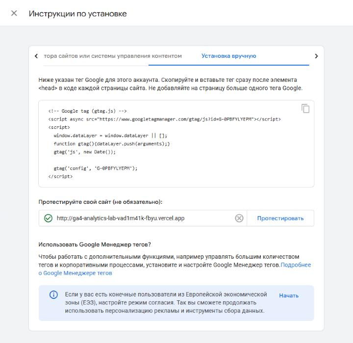
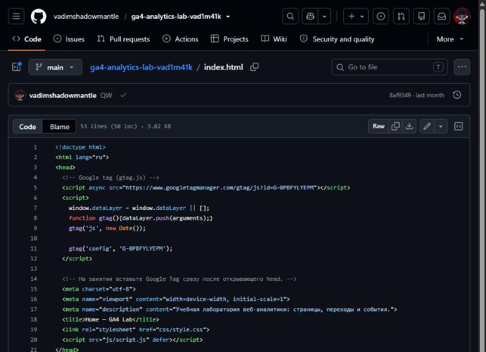
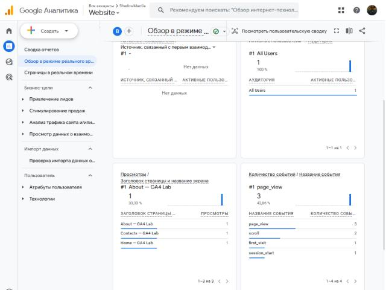
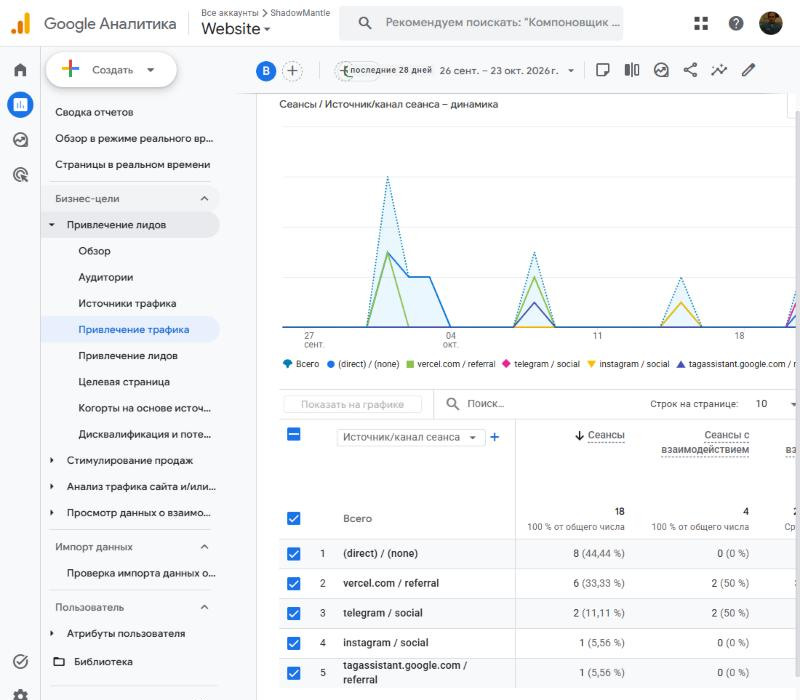
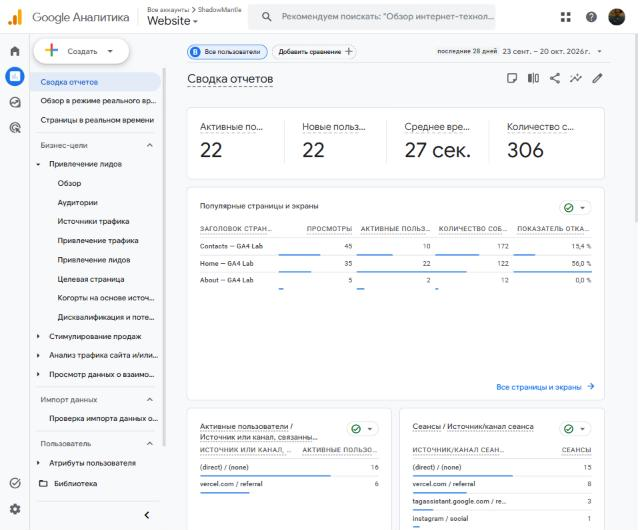

# Домашняя работа № 3 · Тег на сайте, источник и отчёты GA4

**Дисциплина:** ОП.03 «Информационные технологии»

| Поле | Значение |
|---|---|
| Фамилия, имя, отчество | Бурмистров Вадим Александрович |
| Группа | 11/1-РПО-26/1 |
| Номер работы | 3 |
| Тема работы | Установка Google Tag, источник перехода и отчёты GA4 |
| Дата сдачи | 21.10.2026 |

---

## 1. Мой сайт и мой ресурс

| Поле | Значение |
|---|---|
| Адрес репозитория сайта | https://github.com/vadimshadowmantle/ga4-analytics-lab-vad1m41k |
| Публичный адрес сайта | https://ga4-analytics-lab-vad1m41k-fbyu.vercel.app |
| Статус публикации | READY |
| Analytics Account | ShadowMantle |
| Property | Website |
| Stream name | Student Analytics Website |
| Website URL в потоке | http://ga4-analytics-lab-vad1m41k-fbyu.vercel.app |
| Measurement ID (`G-…`) | G-0PBFYLYEPM |
| Страницы с тегом | `index.html`, `about.html`, `contacts.html` |

Тег ставится на каждую страницу по одному разу: две копии дают двойные
события.

## 2. Тег установлен

**Результат проверки из инструкции тега:**

> Администратор → Потоки данных → Student Analytics Website → Просмотр
> инструкций тега → Установка вручную → «Протестируйте свой сайт»: после
> нажатия «Протестировать» у адреса `ga4-analytics-lab-vad1m41k-fbyu.vercel.app`
> появилась зелёная галочка — тег Google на сайте обнаружен.





## 3. События доходят до аналитики

| Поле | Значение |
|---|---|
| Дата и время проверки | 21.10.2026, 19:22 (МСК) |
| Какие страницы открывали | Home (`/`), About (`/about.html`), Contacts (`/contacts.html`) |
| Какие события появились в Realtime | `page_view` (3), `scroll` (2), `first_visit` (1), `session_start` (1) |
| Число активных пользователей в момент проверки | 1 |



## 4. Источник перехода определился

Ссылка собирается с метками `utm_source`, `utm_medium`, `utm_campaign`
и открывается на своём сайте.

**Ссылка целиком:**

```
https://ga4-analytics-lab-vad1m41k-fbyu.vercel.app/?utm_source=telegram&utm_medium=social&utm_campaign=ga4_lab
```

| Поле | Значение |
|---|---|
| Где в GA4 виден источник | Отчёты → Привлечение трафика, параметр «Источник/канал сеанса», период 26.09–23.10.2026 |
| Какое значение источника показал GA4 | `telegram / social` — 2 сеанса |
| Совпадает с `utm_source` из ссылки | да |



Источник и кампания из UTM в отчёте Realtime не показываются: эти измерения
вычисляются при обработке данных. Если в Realtime источника нет, смотрите
отчёт по источникам трафика в разделе «Отчёты».

## 5. Статистика на странице «Отчёты»

| Показатель | Значение | Период |
|---|---|---|
| Пользователи | 22 активных, все 22 новые | 23.09–20.10.2026 (последние 28 дней) |
| Сеансы | 27 | 23.09–20.10.2026 |
| События | 306 | 23.09–20.10.2026 |
| Самое частое событие | `page_view` — 85 (27,78 % всех событий) | 23.09–20.10.2026 |



**Что видно по этим числам** (2–3 предложения):

> На сайт заходили 22 человека, и почти все пришли напрямую (16 пользователей
> `(direct) / (none)`) или из Vercel (6), потому что ссылку открывали
> из панели публикации и адресной строки. Больше всего действий на странице
> Contacts: 45 просмотров и 172 события, там стоит форма. На одного
> пользователя приходится в среднем 27 секунд взаимодействия — сайт учебный,
> его открывают ради проверки.

## 6. Что не получилось

>

## 7. Использование ИИ

Тег вы устанавливаете, проверяете и снимаете кадры сами. ИИ допускается
для формулировок и оформления.

| Вопрос | Ответ |
|---|---|
| Что сделано самостоятельно |  |
| Что спрошено у модели |  |
| Что после этого изменено |  |
