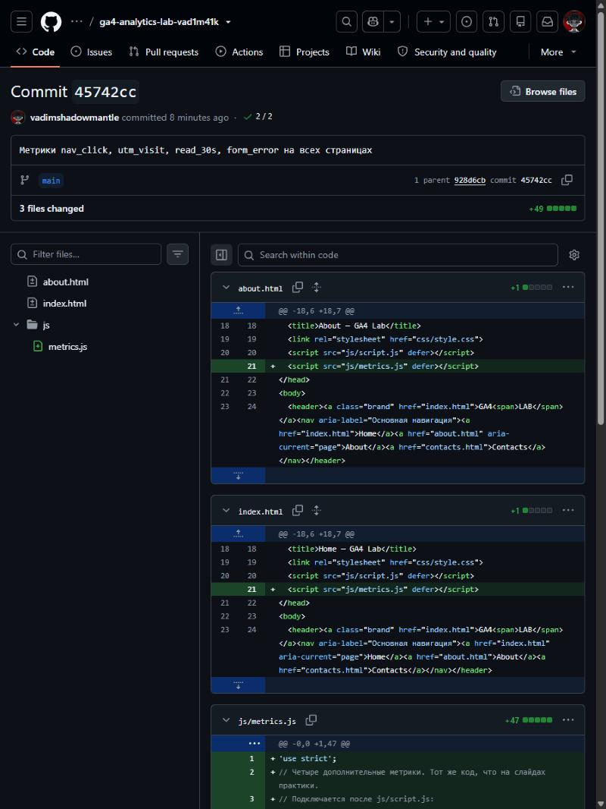
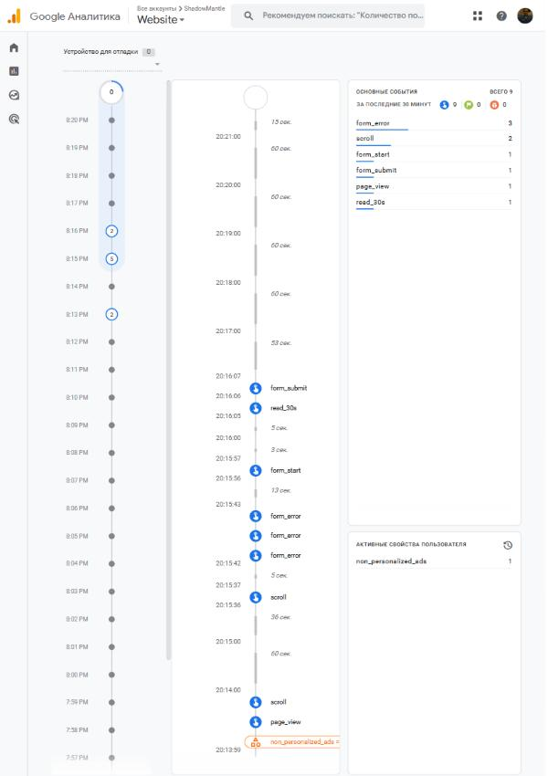
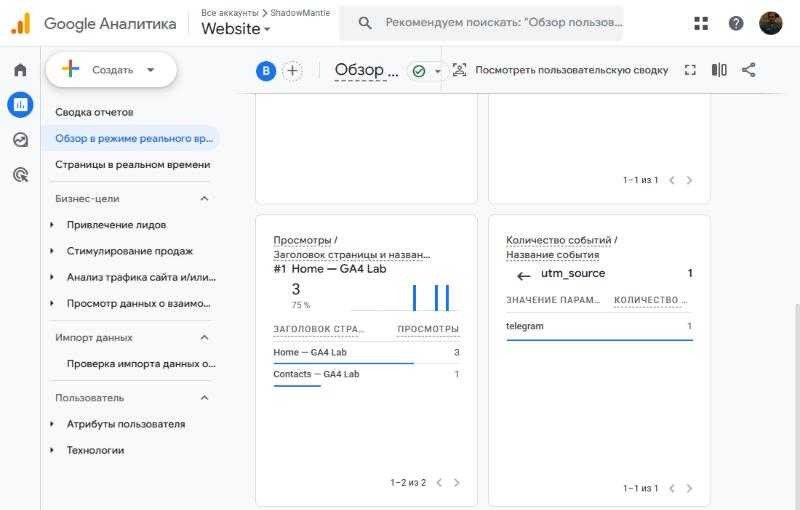
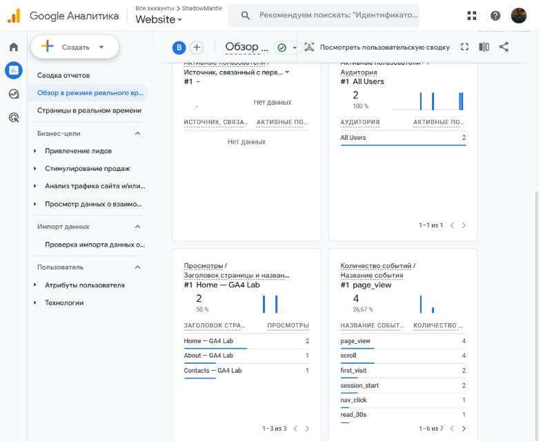

# Домашняя работа № 4 · Свои события и параметры в GA4

**Дисциплина:** ОП.03 «Информационные технологии»

| Поле | Значение |
|---|---|
| Фамилия, имя, отчество | Бурмистров Вадим Александрович |
| Группа | 11/1-РПО-26/1 |
| Номер работы | 4 |
| Тема работы | Свои события и параметры: четыре метрики на сайте |
| Дата сдачи | 21.10.2026 |

---

## 1. Мой сайт и мой ресурс

| Поле | Значение |
|---|---|
| Публичный адрес сайта | https://ga4-analytics-lab-vad1m41k-fbyu.vercel.app |
| Measurement ID (`G-…`) | G-0PBFYLYEPM |
| Коммит с метриками (ссылка или первые 7 символов) | [45742cc](https://github.com/vadimshadowmantle/ga4-analytics-lab-vad1m41k/commit/45742cc) |
| Статус публикации | READY |
| Страницы, где подключён `js/metrics.js` | `index.html`, `about.html`, `contacts.html` |

Файл подключается после основного скрипта и на каждой странице по одному
разу: два подключения дают двойные события.

## 2. Какие метрики добавлены

| Событие | Что измеряет | Что делали, чтобы оно сработало |
|---|---|---|
| `nav_click` | клики по пунктам меню | на главной нажал пункт меню Contacts |
| `utm_visit` | метки кампании из адреса | открыл сайт по ссылке с `utm_source=telegram&utm_medium=social&utm_campaign=ga4_lab` |
| `read_30s` | полминуты на странице | пробыл на главной 30 секунд, не сворачивая вкладку |
| `form_error` | форма не прошла проверку браузера | на Contacts нажал «Отправить заявку» с пустыми полями: браузер не отправил форму, событие ушло по каждому из трёх обязательных полей |



## 3. События в DebugView

| Поле | Значение |
|---|---|
| Дата и время проверки | 21.10.2026, 20:13–20:23 (МСК) |
| Как подключали отладку | Tag Assistant |
| Какие из четырёх событий пришли | `form_error` (3 — по одному на каждое пустое обязательное поле), `read_30s` |
| Какие не пришли и почему | `nav_click` и `utm_visit` в ленту отладки не попали. `nav_click` уходит в момент перехода на другую страницу, и в отладке его не видно, но в Realtime он есть (1). `utm_visit` в окне Tag Assistant не отправился, хотя `page_location` содержал все три метки; при обычном открытии той же ссылки событие уходит и видно в Realtime |



## 4. Параметры события `utm_visit`

**Ссылка, по которой открывали сайт:**

```
https://ga4-analytics-lab-vad1m41k-fbyu.vercel.app/?utm_source=telegram&utm_medium=social&utm_campaign=ga4_lab
```

| Параметр | Значение в ссылке | Значение в GA4 |
|---|---|---|
| `utm_source` | `telegram` | `telegram` |
| `utm_medium` | `social` | `social` |
| `utm_campaign` | `ga4_lab` | `ga4_lab` |
| `landing_page` | — | `/` |

Так как `utm_visit` не дошло до DebugView, событие раскрыто в Realtime:
карточка «Количество событий» → `utm_visit` → `utm_source` → `telegram`.
Значения `utm_medium`, `utm_campaign` и `landing_page` сверены
с параметрами отправленного запроса `collect` (`ep.utm_medium=social`,
`ep.utm_campaign=ga4_lab`, `ep.landing_page=/`).



Если значение в GA4 отличается от значения в ссылке, напишите, в чём разница
и почему так вышло.

> Значения совпадают со ссылкой, разницы нет.

## 5. Событие вне отладки

| Поле | Значение |
|---|---|
| Где проверяли | Realtime |
| Какое событие искали | `nav_click` и `read_30s` (на второй странице карточки — `utm_visit`) |
| Сколько срабатываний показал экран | `nav_click` — 1, `read_30s` — 1 |
| Период (для отчёта) | последние 30 минут, 21.10.2026, 19:40 |



## 6. Что эти метрики показывают про сайт

Два-три предложения: что вы узнали о поведении посетителей из четырёх
новых событий. Например, по каким пунктам меню ходят чаще, доходит ли
кто-то до получаса чтения, спотыкается ли форма.

> Пока данных мало: события пришли только от моей проверки, поэтому выводы
> о посетителях делать рано. Но теперь видно, откуда человек пришёл
> (`utm_visit` с метками), дочитал ли страницу (`read_30s`), куда пошёл
> по меню (`nav_click`) и на каком поле споткнулся в форме (`form_error`
> с `field_name`). Через неделю трафика по этим событиям можно будет
> сравнить, какой источник приводит людей, которые читают и доходят до формы.

## 7. Что не получилось

Если какая-то метрика не заработала, напишите какая, что показывал экран
и что было проверено по таблице из `README.md`. Незаполненный раздел
означает, что всё получилось.

>

## 8. Использование ИИ

Скрипты метрик выданы готовыми. Подключение, проверку и кадры вы делаете
сами. ИИ допускается для формулировок и оформления.

| Вопрос | Ответ |
|---|---|
| Что сделано самостоятельно |  |
| Что спрошено у модели |  |
| Что после этого изменено |  |
