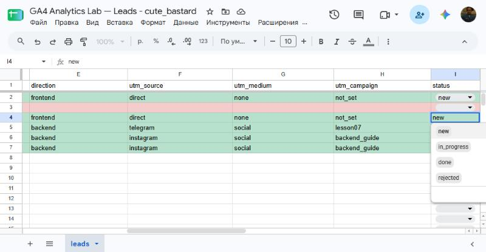
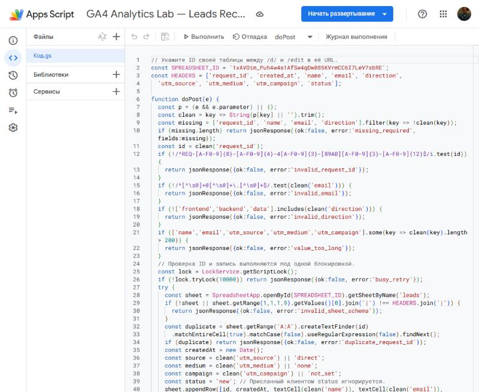
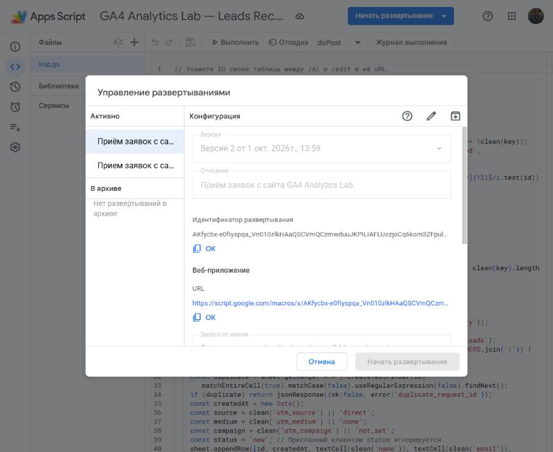
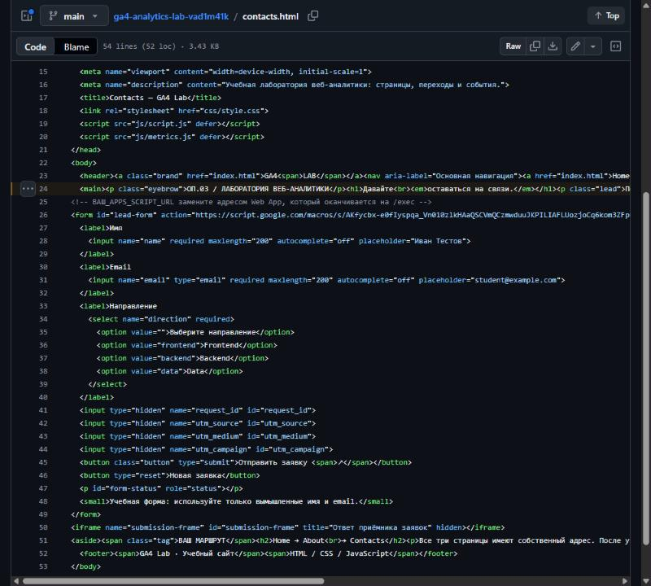
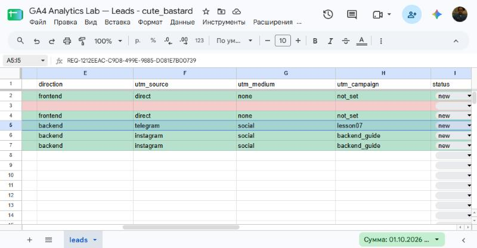
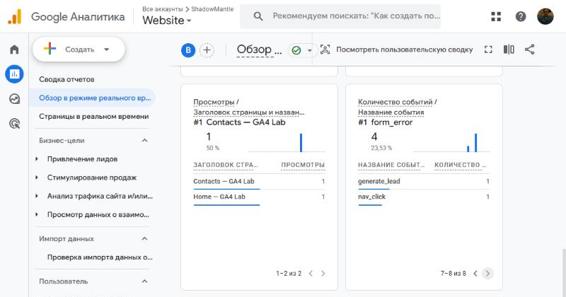
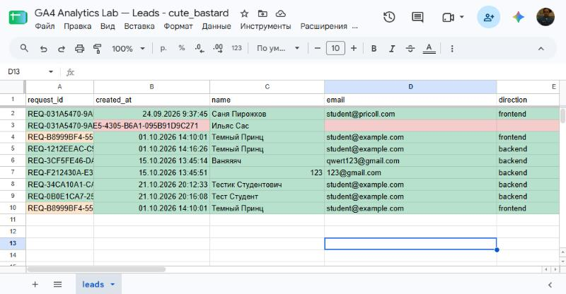
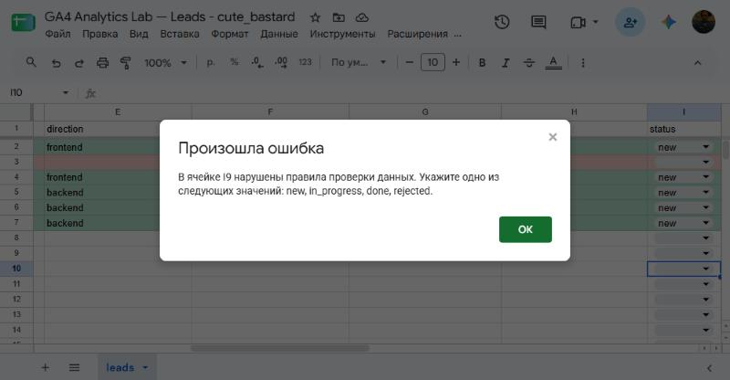

# Домашняя работа № 5 · Контролируемая таблица заявок

**Дисциплина:** ОП.03 «Информационные технологии»

| Поле | Значение |
|---|---|
| Фамилия, имя, отчество | Бурмистров Вадим Александрович |
| Группа | 11/1-РПО-26/1 |
| Номер работы | 5 |
| Тема работы | Форма сайта → Apps Script → Google Таблица заявок |
| Дата сдачи | 21.10.2026 |

---

## 1. Таблица

Я создал таблицу «GA4 Analytics Lab — Leads» с листом `leads`. В первой
строке девять заголовков: `request_id`, `created_at`, `name`, `email`,
`direction`, `utm_source`, `utm_medium`, `utm_campaign`, `status`. Строка
заголовков закреплена, у статуса список из четырёх значений: `new`,
`in_progress`, `done`, `rejected`. Два правила подсвечивают неполную строку
и повторный `request_id`.

Ссылка на таблицу (доступ открыт только преподавателю): https://docs.google.com/spreadsheets/d/1xAVOim_Puh4w4s1AfSw4qDw085KVrmCC6I7LeV7sbRE/edit

## 2. Приёмник и форма

Я вставил `Code.gs` из материалов в Apps Script, указал ID своей таблицы
и опубликовал проект как Web app. Форму в `contacts.html` заменил
фрагментом из материалов, в `action` поставил адрес своего Web app,
обработчик формы в `js/script.js` заменил новым.

| Мои данные | Значение |
|---|---|
| Публичный адрес сайта | https://ga4-analytics-lab-vad1m41k-fbyu.vercel.app |
| Measurement ID (`G-…`) | G-0PBFYLYEPM |
| Коммит с новой формой (первые 7 символов) | `d1b5abf` — форма и обработчик, `7d54632` — адрес Web app в `action` |

## 3. Две тестовые заявки

Первую заявку я отправил со страницы без меток: в таблице записалось
`direct` / `none` / `not_set` и статус `new`. Вторую отправил по ссылке
с метками `telegram` / `social` / `lesson07`, и они записались в свои
столбцы.

| | Заявка без меток | Заявка с метками |
|---|---|---|
| `request_id` | `REQ-B8999BF4-5551-4882-816A-38CAD079DF40` | `REQ-1212EEAC-C9D8-499E-9885-D081E7B00739` |

## 4. Событие в аналитике

После отправки в GA4 пришло событие `generate_lead`. Оно показывает
попытку отправки формы, а сама заявка подтверждается строкой в таблице.

## 5. Проверки

Форма с пустыми обязательными полями не отправилась: браузер остановил
отправку, а в GA4 ушло событие `form_error`. Повторный `request_id` приёмник
не записывает: `Code.gs` ищет такой ID в столбце A и отвечает
`duplicate_request_id`. Копия строки `REQ-B8999BF4-…` в строке 10
сначала не подсветилась: правило дублей стояло последним, и его перекрывало
правило «Ячейка с данными». Я поднял правило дублей в начало списка, после
этого обе ячейки с одинаковым `request_id` стали оранжевыми. После кадра
копию удалил. Статус `approved` таблица не приняла: «Укажите одно
из следующих значений: new, in_progress, done, rejected». Через список статус
заявки `REQ-031A5470-…C278` сменился `new` → `in_progress` → `done`.

---

Не получилось (если всё работает, оставьте пустым):

ИИ: использовал для оформления текста и кода, данные и настройку делал сам.
